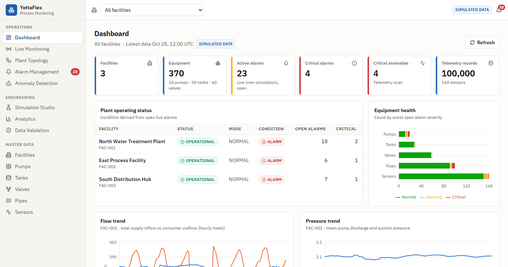
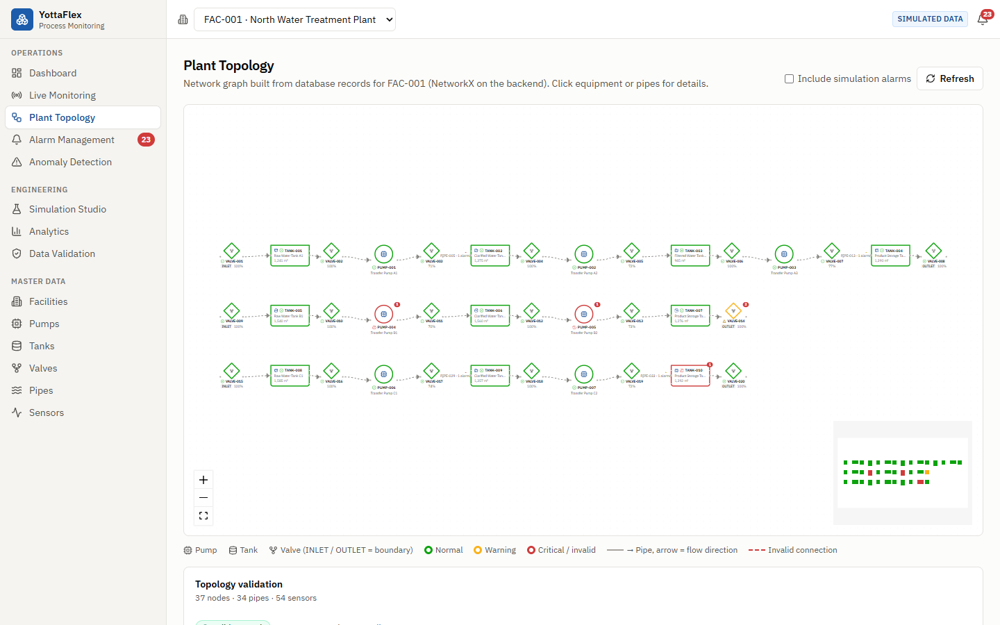
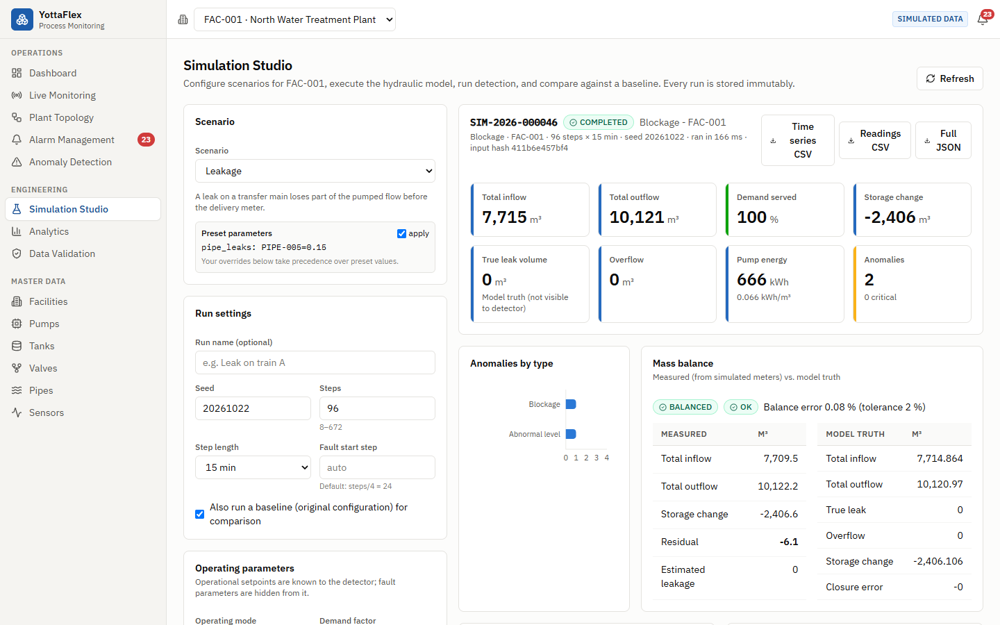
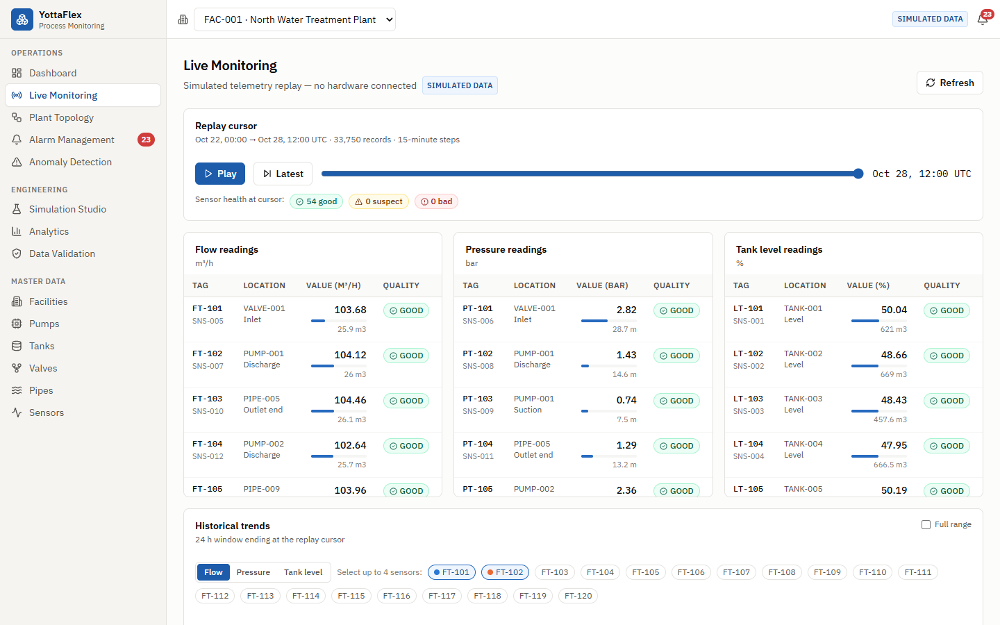
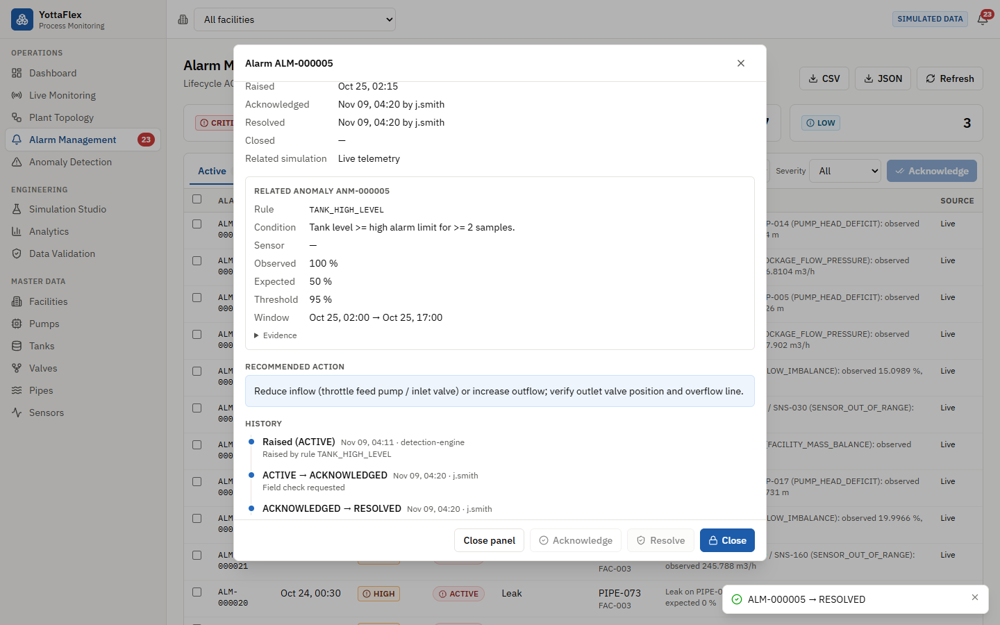
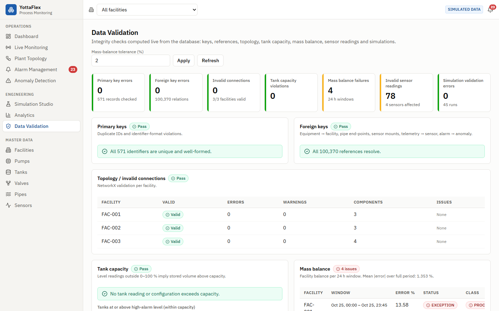

# YottaFlex — Industrial Process Monitoring & Simulation

A locally runnable platform that models interconnected industrial equipment
(facilities, pumps, tanks, valves, pipes, sensors), generates physically
consistent **simulated** telemetry, computes mass balance, detects leaks,
blockages, pump degradation, sensor faults, tank overcapacity and abnormal
flow/pressure with transparent rules, and lets engineers run, persist and
compare what-if simulations.

> All telemetry is synthetic. No physical hardware is connected. The hydraulic
> model is a documented simplification, not a full industrial hydraulic solver.

| Layer | Stack |
|---|---|
| Frontend | React 18, Vite 6, TypeScript, Tailwind CSS, Recharts, React Flow (@xyflow/react), Lucide |
| Backend | Python 3.11+, FastAPI, SQLAlchemy 2, Pydantic 2 |
| Data | SQLite, NumPy, Pandas, NetworkX |
| Tests | pytest (43 tests), end-to-end smoke test (102 checks), ruff, `tsc` |

**For reviewers:** start with [Verify it works](#verify-it-works), then
[Design decisions & trade-offs](docs/DESIGN_DECISIONS.md),
[AI usage disclosure](docs/AI_USAGE.md) and [prompt history](prompt-history/prompts.md).
How the work evolved: [development log](docs/DEVELOPMENT_LOG.md).

---

## Quick start

Prerequisites: Python 3.11+ and Node.js 18+.

### Windows (PowerShell)

The commands call the virtual environment's Python directly, so no `Activate.ps1`
(often blocked by the execution policy) is needed.

```powershell
# One-time setup
cd backend
python -m venv .venv
.\.venv\Scripts\python.exe -m pip install -r requirements.txt
.\.venv\Scripts\python.exe -m scripts.generate_data --seed 20261022 --scale full   # resets + loads the DB (~5 s)
cd ..\frontend
npm install

# Terminal 1 - API on http://localhost:8000  (docs: /docs)
cd backend
.\.venv\Scripts\python.exe -m uvicorn app.main:app --port 8000

# Terminal 2 - UI on http://localhost:5173  (proxies /api to :8000)
cd frontend
npm run dev
```

### macOS / Linux

```bash
cd backend && python3 -m venv .venv && .venv/bin/pip install -r requirements.txt
.venv/bin/python -m scripts.generate_data --seed 20261022 --scale full
.venv/bin/python -m uvicorn app.main:app --port 8000          # terminal 1
cd frontend && npm install && npm run dev                      # terminal 2
```

`--scale starter` generates a 1-day dataset (15,360 telemetry rows) instead of the full
100,000. Re-running `generate_data` **resets the database** (simulations and alarm history
are cleared) — stop the API first.

If `npm run dev` reports port 5174 instead of 5173, an older dev server is still running;
use the URL it prints, or stop the old one.

## Verify it works

Run from `backend/` (on Windows prefix each command with `.\.venv\Scripts\python.exe`, on
macOS/Linux with `.venv/bin/python`). Expected results are in brackets.

| Step | Command | Expected |
|---|---|---|
| 1. Automated tests | `python -m pytest -q` | `43 passed` (uses an isolated temporary database) |
| 2. Reproducible data | `python -m scripts.generate_data --seed 20261022 --scale full` | 100,000 telemetry records; fingerprint `a0e9cdeb47728f67…`; P 1.0 / R 0.8475 / F1 0.9174 |
| 3. End-to-end API check (API running) | `python -m scripts.smoke_test` | `102/102 passed` |
| 4. All scenarios | `python -m scripts.run_scenarios` | 24 runs, each line ends with `OK` |
| 5. Negative cases | `python -m scripts.run_negative_scenarios` | `5/5 negative scenarios detected as expected` |
| 6. Metrics report | `python -m scripts.run_evaluation` | PK/FK errors 0, topology 3/3, metrics as in step 2 |
| 7. Lint and types | `python -m ruff check app scripts tests` · `cd ../frontend; npx tsc --noEmit -p .` | no findings |

In the UI: open **Simulation Studio**, run *Blockage* and compare with its baseline; open **Alarm
Management**, acknowledge → resolve → close an alarm and check its history; open **Data
Validation** to see the five negative cases explained. A guided demo script is in
[docs/WALKTHROUGH.md](docs/WALKTHROUGH.md).

Step 3 adds one simulation run (with baseline and one deliberately failed run) to the database;
re-run step 2 to reset. Dev tooling: `pip install -r requirements-dev.txt` (adds ruff).

## What it does

### Plant model & data
* **3 facilities, 20 pumps, 30 tanks, 60 valves, 100 pipes, 160 sensors**, organised as process
  trains `INLET → tank → pump → tank … → OUTLET`, generated parents-first with deterministic IDs
  (`FAC-001`, `PUMP-001`, `TANK-001`, `VALVE-001`, `PIPE-001`, `SNS-001`, `SIM-2026-000001`).
* **Telemetry**: flow (m³/h), pressure (bar), level (%) every 15 min — 160 × 625 = **100,000 rows**
  (full) — produced by a time-stepping hydraulic engine plus measurement noise, with derived values
  (volume, head, interval volume).
* **Fault injection** (leaks, blockages, pump degradation, five sensor-fault modes, operator-caused
  overfill) with **separate ground truth** (`data/generated/<scale>/ground_truth.json|csv`).
* **Reproducible**: same seed + scale ⇒ byte-identical exports (SHA-256 per file in `manifest.json`).

### Engineering logic
* Pump curve `H(Q) = hf·(s²·H0 − kQ²)` intersected with the system curve (pipes, valves, blockage,
  static head) → flow; tank `V(t+1) = V(t) + (Qin − Qout − Qleak)·Δt`; valves `R = R100/opening²`.
* **Mass balance**: inflow, outflow, storage change, residual, estimated leakage, balance error,
  status (BALANCED / WARNING / EXCEPTION) with configurable tolerance, and classification
  **process imbalance vs measurement fault**.
* **Rule-based detection** with observed / expected / threshold / evidence / recommended action for
  every anomaly; a three-way reconciliation (pump meter, delivery meter, tank level) separates real
  leaks from flow-meter faults. See [docs/ANOMALY_DETECTION_RULES.md](docs/ANOMALY_DETECTION_RULES.md).
* **NetworkX topology** from database records: flow direction, connection rules, components,
  reachability supply→demand, cycles, invalid/missing nodes.

### Simulation studio
Eight scenarios (normal, leakage, blockage, pump degradation, sensor malfunction, high demand, valve
closure, tank overcapacity); configurable pump speed/availability/health, valve opening, tank initial
level, flow demand, pipe restriction/leak, sensor faults, operating mode. Every run validates inputs,
stores original + modified + effective configuration, outputs, mass balance, anomalies, alarms and
assumptions under a new immutable `SIM-<year>-<seq>` id, runs a linked baseline, and can be compared
and exported (CSV/JSON).

### Alarms
One alarm per anomaly; lifecycle **ACTIVE → ACKNOWLEDGED → RESOLVED → CLOSED** enforced (409 on
invalid transitions), every change appended to `alarm_events`.

### Frontend pages
Dashboard · Live Monitoring (simulated telemetry replay) · Plant Topology (React Flow) · Alarm
Management · Anomaly Detection · Simulation Studio · Analytics (incl. detection evaluation) · Data
Validation (incl. negative scenarios) · Facilities · Pumps / Tanks / Valves / Pipes / Sensors (CRUD).
Every number and chart is fetched from the API; there is no hard-coded data.

## Screenshots

| Dashboard | Plant topology |
|---|---|
|  |  |
| **Simulation studio** | **Live monitoring (simulated replay)** |
|  |  |
| **Alarm lifecycle** | **Data validation** |
|  |  |

## Results (seed 20261022, full scale)

| Metric | Value |
|---|---|
| Telemetry records | 100,000 (160 sensors × 625 steps) |
| Detection precision / recall / F1 (window-based) | 1.000 / 0.848 / 0.917 |
| Events detected | 20 / 23 — the 3 misses are deliberate below-threshold detection-limit tests |
| Sensor faults mislabelled as process faults | 0 |
| PK / FK integrity, duplicates | 100 % / 100 %, 0 |
| Topology validity | 3 / 3 facilities |
| Scenario runs with expected detection | 24 / 24 |
| Negative scenarios caught | 5 / 5 |
| Automated tests | 43 passed |

See [docs/VALIDATION_SUMMARY.md](docs/VALIDATION_SUMMARY.md) for the complete, reproducible numbers
(detection confusion matrices, data-quality metrics, scenario runs, negative cases, test results).

## Repository layout

```
backend/
  app/
    api/                 FastAPI routers (equipment, telemetry, operations, insights)
    models/              SQLAlchemy entities
    schemas/             Pydantic request/response models
    services/            ids, references, telemetry, mass balance, anomalies, alarms, evaluation
    simulation/          hydraulics, process model, engine, sensors, scenarios, runner
    anomaly_detection/   rules (thresholds, severities) + detector
    topology/            NetworkX graph, validation, layout
    validation/          integrity checks + negative scenarios
    generation/          master-data layout, fault injection, dataset generator
    config.py database.py main.py
  negative_cases/        deliberate invalid fixtures (never loaded into the baseline DB)
  scripts/               generate_data, run_scenarios, run_evaluation, run_negative_scenarios, smoke_test
  tests/                 pytest suite
frontend/
  src/api/               central API client + types
  src/components/        layout, UI kit, hooks, chart conventions
  src/pages/             one file per page
docs/                    architecture, schema, dictionary, assumptions, rules, API, validation, limitations
prompt-history/prompts.md
```

## Documentation

* [Architecture](docs/ARCHITECTURE.md)
* [Database schema](docs/DATABASE_SCHEMA.md)
* [Data dictionary](docs/DATA_DICTIONARY.md)
* [Simulation assumptions & hydraulic model](docs/SIMULATION_ASSUMPTIONS.md)
* [Anomaly detection rules](docs/ANOMALY_DETECTION_RULES.md)
* [API reference](docs/API.md)
* [Validation summary](docs/VALIDATION_SUMMARY.md)
* [Known limitations](docs/KNOWN_LIMITATIONS.md)
* [Design decisions, assumptions & trade-offs](docs/DESIGN_DECISIONS.md)
* [AI usage disclosure](docs/AI_USAGE.md)
* [AI prompt history](prompt-history/prompts.md)
* [Development log](docs/DEVELOPMENT_LOG.md)
* [Walkthrough guide](docs/WALKTHROUGH.md)

## Configuration

No secrets are required. Optional environment variables are listed in `backend/.env.example`
(`YOTTAFLEX_DB_URL`, `YOTTAFLEX_DATA_DIR`, `YOTTAFLEX_MB_TOLERANCE_PCT`, `YOTTAFLEX_CORS_ORIGINS`).
Generated data and the SQLite database live in `backend/data/` (git-ignored; recreate with
`scripts.generate_data`).
